# Alone in Mars (MarsWalk)

> **Team Name:** Cabezones de la NASA  
> **Local Event / Universal Event:** NASA Space Apps Challenge 2026  
> **Challenge:** Interplanetary Survival Guide: Martian Map  
> **Division:** Planetary Science Division / Space Operations  

<div align="center">
  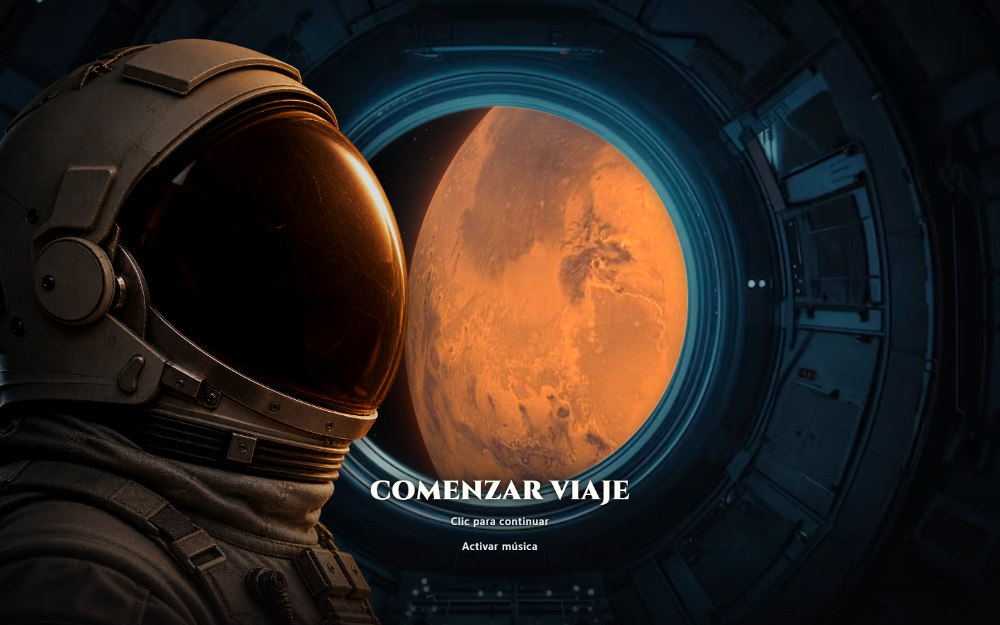
  <br>
  <p><i>"On Earth, a map tells you how to get there. 225 million kilometers from home, a map decides whether you'll breathe again..."</i></p>
</div>

---

## 1. Project Summary

### Project Name
`Alone in Mars — 3D Martian EVA Mission Planner & Surface Survival Simulator`

### Summary *
*(Target: 50–200 words | Hard limit: 1,500 characters — 145 words / 1,045 characters)*

- **What did you develop?** **Alone in Mars (MarsWalk)** is an interactive 3D Martian mission planner and first-person extravehicular activity (EVA) surface simulator built around Jezero Crater. It unites an orbital telemetry and GIS dashboard with full-scale surface exploration, vehicle driving, and an interactive rover companion.
- **How does it address the challenge?** The platform fuses five NASA and USGS data layers—CTX/HiRISE elevation, terrain slope, hazard index, CRISM mineralogy, and THEMIS thermal inertia—into 17 mathematical models (`M1`–`M17`). Three routing engines (Classic A\* O₂, Multi-Dimensional Health A\*, and a QAOA-inspired layered corridor) adapt to xEMU suit limits and crew physiology to guide parachute landing, sample collection, and MEDA dust storm evacuation.
- **Why is it important?** Because Earth–Mars signals take up to 22 minutes each way, future explorers need autonomous, physiologically grounded survival maps, while students and educators gain an accessible scientific window into Martian operations.

---

## 2. Project Links

### Project Demonstration *
- **URL:** `https://[public-demo-video-url-to-be-added]` *(28-second narrated video cut synchronized with ElevenLabs voiceover and Google Flow / web captures; see Section 4.1 for the 0:00–0:28 production timeline)*
- **Requirements:**
  - Hosted as a **≤ 30-second video** (target runtime: `27–28 s`) on a public platform (YouTube, Google Drive, GitHub, OneDrive, or Dropbox).
  - **No password, login, permission request, or registration required.**

### Project *
- **Live Web Application (GitHub Pages):** `https://cabezones-de-la-nasa.github.io/MarsWalker/`
- **Source Code Repository (GitHub):** `https://github.com/Cabezones-de-la-NASA/MarsWalker`
- **Standalone Offline 360° Habitat Viewer (NS-02):** `https://cabezones-de-la-nasa.github.io/MarsWalker/models3d/base-terrestre-ns-02/base-terrestre-ns-02-360.html`
- **Requirements:**
  - Publicly accessible prototype and full source code deployed directly from `main` via GitHub Actions (`.github/workflows/deploy.yml`).
  - **No password, login, permission request, or registration required.**

---

## 3. Project Details *

### 3.1 Problem & Solution (What It Does)

- **The Challenge Gap:** Decades of NASA orbital missions have produced breathtaking maps of Mars, yet an orbital image alone cannot tell an astronaut on foot whether the ridge ahead exceeds a safe 25° climbing limit, whether a detour spikes metabolic oxygen consumption beyond their suit's 580 L tank, or how fast a crew must evacuate to shelter when a local dust storm drops visibility from kilometers to tens of meters.
- **Our Solution:** **Alone in Mars (MarsWalk)** transforms raw Jezero Crater elevation and planetary science data into an interactive, dual-mode survival simulator:
  1. **Atmospheric Prologue & Onboarding:** A cockpit journey from orbit zooms straight into Jezero Crater, accompanied by a guided interactive dashboard onboarding (with a persistent *"Do not show again"* toggle and on-demand `?` help trigger).
  2. **3D Orbital Mission Dashboard:** Inspect Jezero at 20 m/px (`jezero_ctx`) or 1 m/px (`hirise_jezero`), toggle 5 terrain/science layers, customize up to 6 astronauts (body mass, age, sex, aerobic fitness), inspect every underlying equation in the **Formulas** tab, place custom bases/objectives, and drag the orange drop pin anywhere to land.
  3. **Surface Exploration, Rover AI & First Contact Mission:** Descend by parachute capsule onto real terrain, walk or sprint under Martian gravity (3.71 m/s²), inspect Perseverance rock-core samples with NASA imagery and citations, drive the 6×6 rover in exterior or first-person cabin views, speak with or text the AI rover companion (with automatic offline fallback to verified `MARS_FACTS`), and survive dynamic dust storms.
- **Target Users:** Analog mission planners, aerospace & planetary science students, STEM educators, and general space-exploration audiences.

---

### 🖼️ Visual Showcase & Mission Gallery

#### 🚀 1. Orbital Introduction, Planet Rendering & Parachute Descent
From the introductory spacecraft cockpit and Viking-textured rotating globe into real Jezero topography via capsule parachute descent.

<table align="center">
  <tr>
    <td width="50%"><b>Introductory Cabin ("Start Journey")</b><br></td>
    <td width="50%"><b>3D Mars Orbital Prototype</b><br>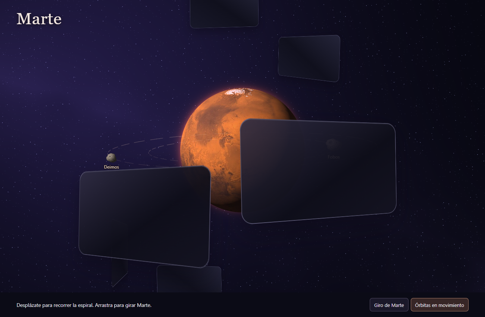</td>
  </tr>
  <tr>
    <td width="50%"><b>Orbital Transit Sequence</b><br>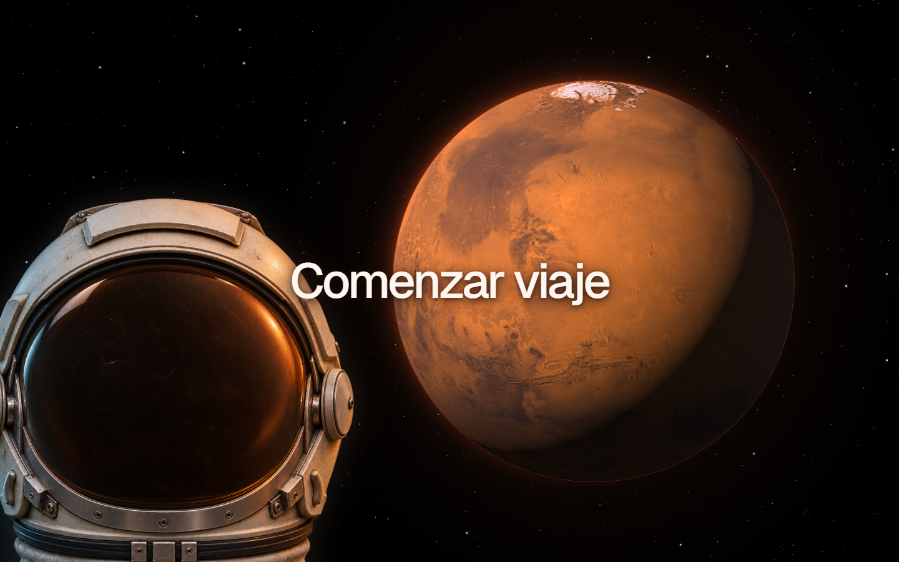</td>
    <td width="50%"><b>Parachute Descent Capsule HUD</b><br>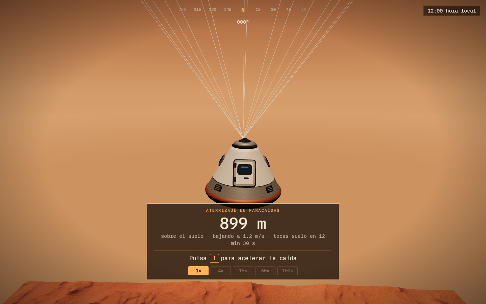</td>
  </tr>
</table>

#### 👩‍🚀 2. Surface Architecture: EVA-07 Design, NS-02 Ground Habitat & 360° Inspector
A four-view astronaut character design specification paired with the three-module NS-02 surface station—inspectable both inside the playable terrain and inside a self-contained offline 360° WebGL 2 viewer.

<table align="center">
  <tr>
    <td width="50%"><b>EVA-07 Astronaut Multi-View Reference</b><br>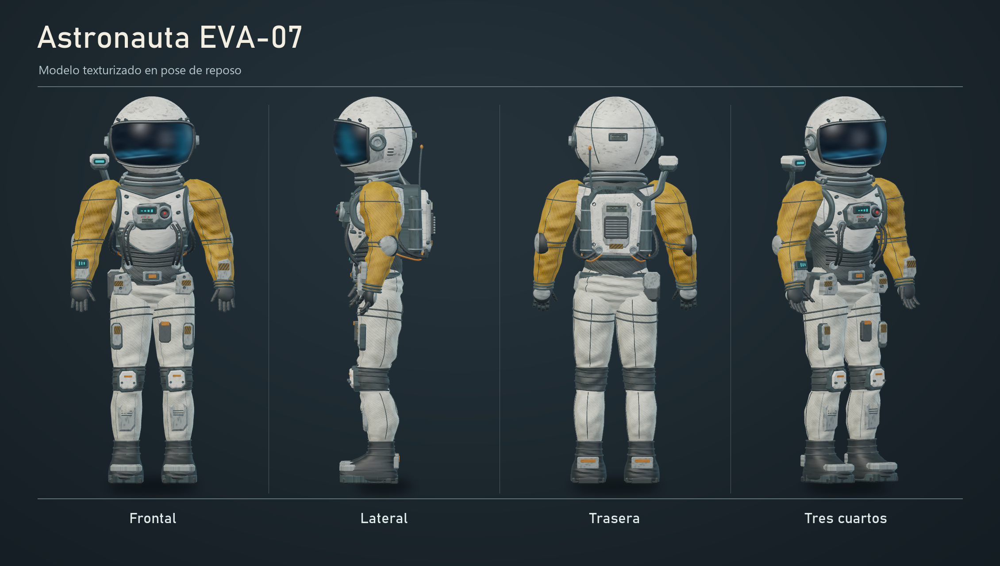</td>
    <td width="50%"><b>NS-02 Habitat Deployed on Jezero Terrain</b><br>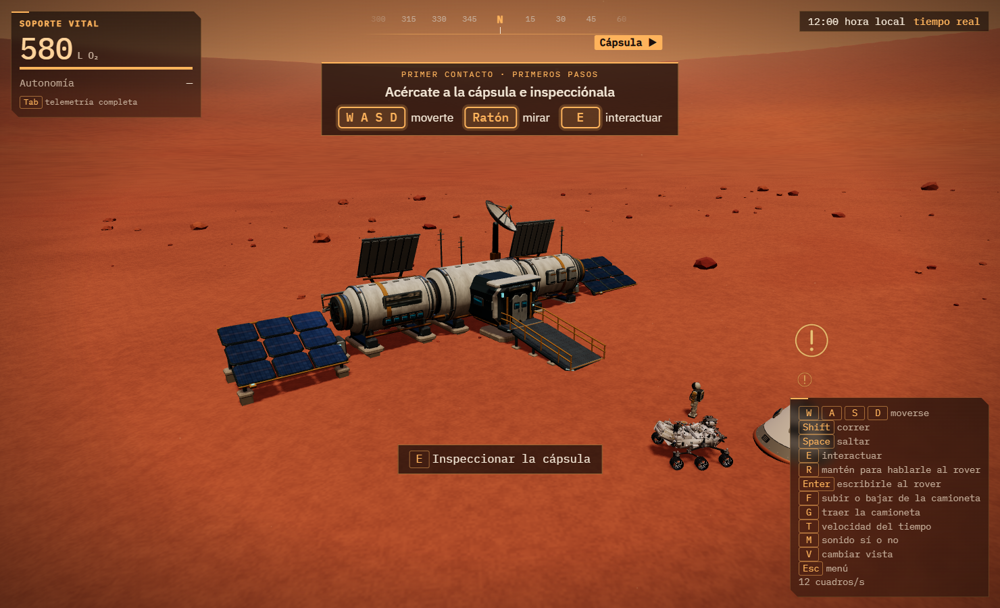</td>
  </tr>
  <tr>
    <td width="50%"><b>NS-02 Offline 360° WebGL Viewer</b><br>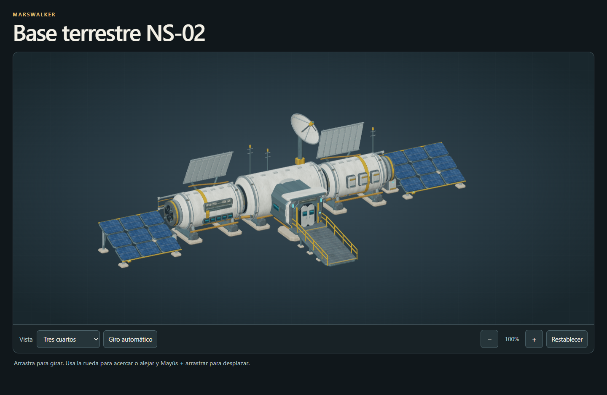</td>
    <td width="50%"><b>3D Models Tab Inside Web App</b><br>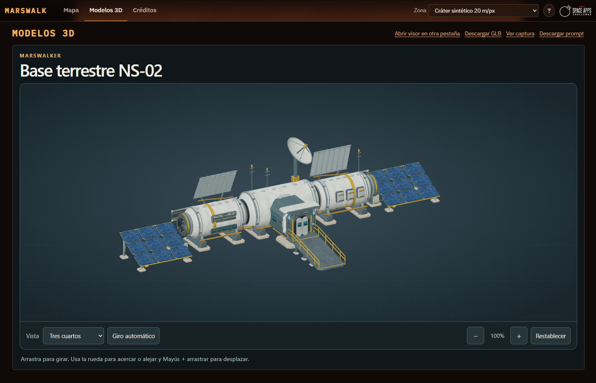</td>
  </tr>
</table>

<div align="center">
  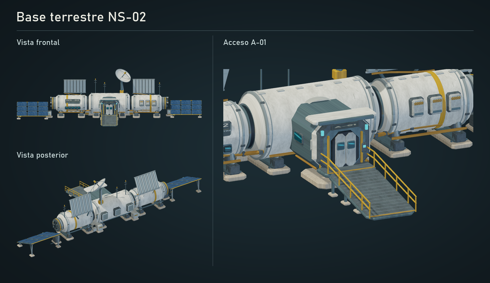
</div>

#### 🚙 3. Martian 6×6 Surface Vehicle — Exterior vs. First-Person Cockpit
Six articulated wheels, visible suspension, and a modeled interior featuring instruments, pedals, switches, and steering wheel (`F` to board/exit, `V` to switch camera).

<table align="center">
  <tr>
    <th colspan="2">Surface Driving Perspectives</th>
  </tr>
  <tr>
    <td width="50%"><b>Exterior Surface Exploration</b><br>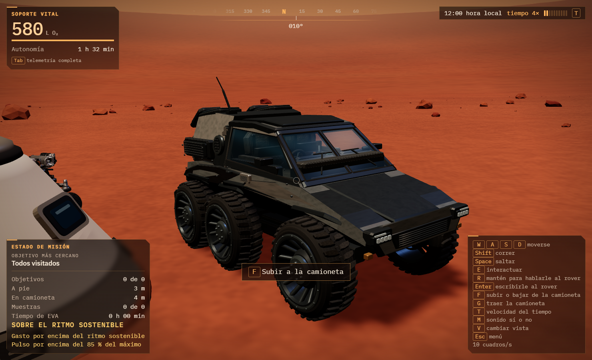</td>
    <td width="50%"><b>First-Person Driver Cockpit</b><br>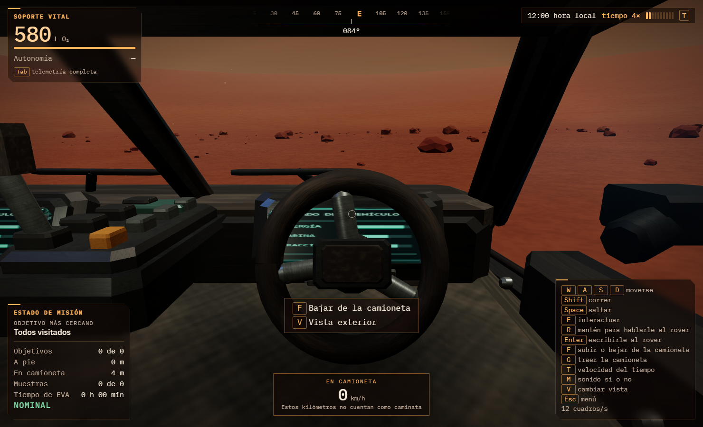</td>
  </tr>
</table>

#### 🌪️ 4. Dynamic Martian Dust Storm Progression (`M16` – `M17`)
Real-time atmospheric optical depth (τ) progression reducing direct solar irradiance, shortening visibility from kilometers to meters, muffling storm audio inside the 6×6 cabin, and covering footsteps with wind-blown regolith.

<table align="center">
  <tr>
    <td width="33.3%"><b>Clear Sky (τ = 0.5 · ~5,550 m vis.)</b><br>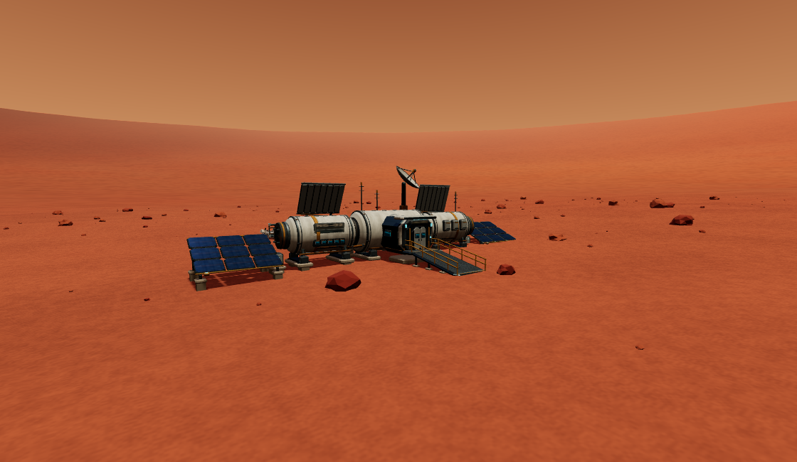</td>
    <td width="33.3%"><b>Approaching Front (τ = 4.0 · ~106 m vis.)</b><br>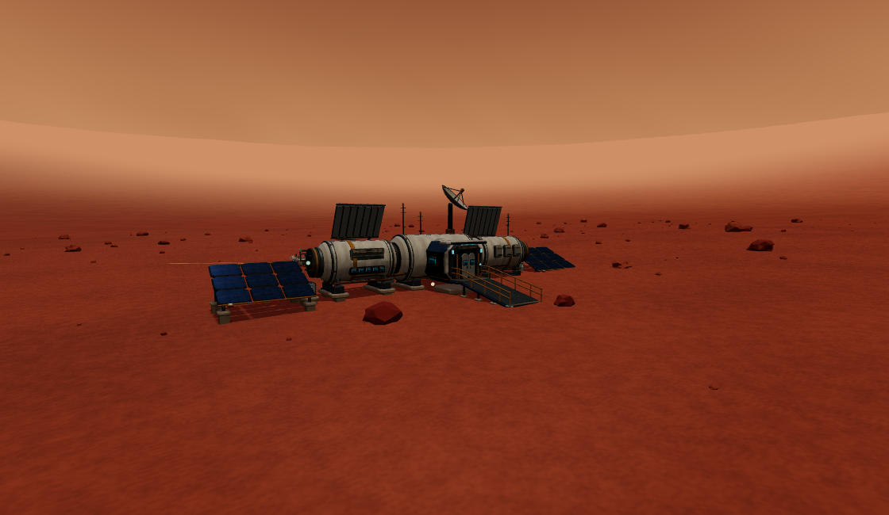</td>
    <td width="33.3%"><b>Peak Storm (τ = 8.5 · ~26 m vis.)</b><br>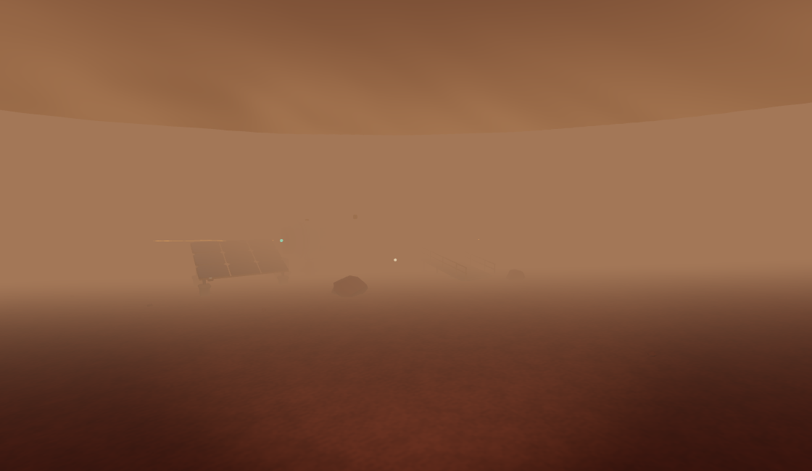</td>
  </tr>
</table>

---

### 3.2 How It Works & Technical Architecture

- **End-to-End Workflow:**
  1. **Data Pipeline (`data_pipeline/`):** Pure-Python GeoTIFF converters (`convert_dem.py`, `validate.py`, `compare_slope_d5.py`, `fit_meda_temperature.py`) normalize USGS CTX and HiRISE DTMs into compact Float32 little-endian heightmaps (`heightmap.f32`), base shading textures (`texture.png`), metadata (`metadata.json`), and cited NASA points of interest (`poi.json`).
  2. **Pure Mathematical Simulation Engine (`src/models/`):** 17 isolated, framework-free models (`M1`–`M17`) compute terrain gradients, pathfinding costs inside a dedicated Web Worker (`route_worker.js`), crew physiology, suit life support, and planetary weather without touching Three.js or the DOM.
  3. **Shared 3D World & Dual Interface (`src/world/`, `src/dashboard/`, `src/gameplay/`):** A single Three.js scene renders Jezero terrain, procedural micro-relief, slope-weighted boulder fields, atmospheric shaders, and 3D vehicles/habitats, switching smoothly between the orbital GIS planner and first/third-person EVA exploration.

- **Key Technical Innovations:**
  - **Three-Engine EVA Route Planner (`M3`, `M4`, `M14`, `M15`):**
    - *Classic A\* Oxygen (M3–M4):* Minimizes oxygen expenditure using an admissible straight-line heuristic over an 8-neighbor binary-heap grid, applying a steep penalty `P(θ)` beyond safe slope limit `θ_safe = 25°`.
    - *Multi-Dimensional Crew Health A\* (M14):* Simulates `M13` crew walking along each terrain edge and weighs seven physiological dimensions (slope, metabolic peak vs. `M_sust`, heart rate, O₂ per meter, thermal strain, dehydration deficit, and cosmic radiation) across four presets (`Classic`, `Scientific`, `Balanced`, `Safety`).
    - *QAOA-Inspired Layered Corridor (M15):* A classical heuristic (explicitly labeled as non-quantum) inspired by Farhi, Goldstone, and Gutmann (2014) that discretizes `S ∈ [18, 48]` transverse layers with `K = 25` candidates per layer, alternating cost weighting (γ) and lateral neighbor mixing (β) across `p = 4` rounds before extracting the minimum-energy path via dynamic programming.
  - **Mars-Adapted xEMU & Crew Physiology (`M5`–`M13`):** Translates Earth Pandolf metabolic rates (`M5`) to Martian gravity (3.71 m/s²) and the 170 kg, 29.6 kPa pressurized xEMU suit (`M6`), tracking Lusk caloric O₂/CO₂ consumption (`M7`), ACSM age-adjusted VO₂max (`M8`), Swain & Leutholtz `%HRR = %VO₂R` heart rate (`M9`), Gagge body heat balance (`M10`), Sawka hydration deficit (`M11`), Curiosity RAD background dose rate (27.9 µSv/h against NASA-STD-3001's 600 mSv career limit, `M12`), and weakest-link crew pacing with 20-minute leader rotations (`M13`).
  - **Solar Irradiance, Diurnal Temperature & Evacuation (`M16`–`M17`):** Models Mars orbital eccentricity (`e = 0.0934`, perihelion `L_s = 251°`), Kasten & Young air mass (`M16`), diurnal ambient temperature wave (`M17`), dynamic storm fronts, cabin audio attenuation, and automatic A\* emergency evacuation paths to the nearest `shelter` POI.

- **System Diagram:**

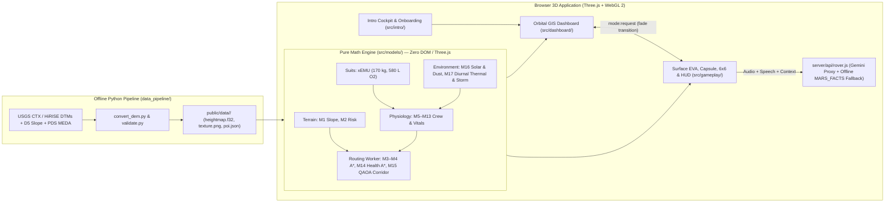

- **Repository Architecture:**

```text
MarsWalker/
├── README.md
├── docs/modelosydb.md                 # Authoritative spec of M1–M17 equations, constants & sources
├── data_pipeline/                     # Standard-library Python DEM converters & D5 slope validator
├── public/
│   ├── data/                          # jezero_ctx (20 m/px), hirise_jezero (1 m/px), jezero_region, synthetic_crater
│   ├── media/                         # Intro music, Mars Viking globe texture, cockpit art, SFX audio
│   └── models3d/                      # Perseverance GLB, NS-02 GLB + 360° viewer, 6×6 vehicle GLB
├── server/                            # Optional Vercel Serverless proxy for Gemini rover chat
├── Promts/                            # AI prompt histories, design references & visual captures
├── src/
│   ├── intro/                         # Cockpit arrival sequence & animated Jezero zoom
│   ├── dashboard/                     # Orbital GIS controls, 5 raster layers, panels, onboarding, views
│   ├── models/                        # M1–M17 pure JS models (terrain, routing, physiology, environment, suits)
│   ├── models3d/                      # Capsule, parachute, NS-02 base, Perseverance, 6×6 & explorer rigs
│   ├── gameplay/                      # First/third-person locomotion, vehicle driving, HUD, sortie, rover chat
│   ├── world/                         # Shared Three.js terrain mesh, sky, dust particles, boulders, quality profiles
│   └── shared/                        # State bus, bilingual i18n (EN/ES), verified Mars facts, mission storage
└── tests/                             # 22 Node test files (172 automated unit & integration tests)
```

---

### 3.3 Validation, Case Study & Results

- **Test Case & Scenarios:**
  1. **Jezero Crater Landing & "First Contact" (*Primer contacto*) EVA:** Starting from orbital planning on `hirise_jezero` (1 m/px HiRISE window) and `jezero_ctx` (20 m/px), landing near the capsule, sampling two ancient river/rock-core sites (`Berea` outcrop and boulder field with Perseverance photography), and evacuating back to Base `NS-02` when a MEDA dust storm hits at `t = 20 s`.
  2. **14° Hill Routing Counterexample (`M14`):** Validated a documented counterexample where Health A\* chooses an uphill detour that slightly increases climb compared to classic oxygen routing while bounding crew peak metabolic strain across all 7 dimensions.

- **Quantitative & Qualitative Results:**

| Verification Area | Metric / Benchmark | Observed Result |
| :--- | :--- | :--- |
| **Automated Test Suite (`npm test`)** | `node --test tests/*.test.js` across 22 files | **172 / 172 tests passing** (0 failed; covers `M1`–`M17`, terrain axes, A\*, QAOA corridor, crew physiology, locomotion, 6×6 physics, dust storm, i18n, and rover offline fallback) |
| **Slope Model Accuracy (`M1` vs. `D5`)** | Inclined analytical planes & USGS `D5` comparison (`compare_slope_d5.py`) | **< 0.1° error** on known analytical planes; centered finite differences aligned with official USGS Jezero West slope raster |
| **Dust Storm Visibility (`M16`–`M17`)** | Simulated midday horizontal visibility across optical depth τ | **5,550 m** at τ = 0.5 (clear) → **~106 m** at τ = 4.0 (active front) → **~26 m** at τ = 8.5 (peak opacity) |
| **Physiological Conservation (`M5`–`M13`)** | Terrestrial boundary equivalence & RER test | Reduces cleanly to Pandolf `M5` when `g_M = g_E`, `f_p = 0`; `E_O₂ = 20.2 kJ/L` at `RER = 0.82`; `223 µSv` dose over 8 h |
| **Playtest Progression** | Surface asset integration | Verified capsule descent, `NS-02` access ramp collisions, `6×6` entry/steering/1st-person cockpit, and full mission completion |

---

### 3.4 Tech Stack & Requirements

| Layer | Technology / Tool | Role in Alone in Mars |
| :--- | :--- | :--- |
| **Frontend & 3D Engine** | Vanilla JavaScript (ES Modules), HTML/CSS, **Three.js `^0.187.0`**, **Google Draco** | Orbital GIS map, 5 compositor raster layers, custom terrain/atmosphere shaders, surface physics & helmet HUD |
| **Typography & Build** | **Vite `^8.3.8`**, **IBM Plex Sans** & **IBM Plex Mono** (`@fontsource`, OFL) | Zero-framework fast bundling, GitHub Pages static deployment, crisp telemetry & LaTeX-style formula views |
| **Concurrency & Web APIs** | **Web Workers**, **WebGL 2**, **Web Audio API**, **Web Speech API** | Non-blocking route search worker, procedural breath/wind/alert synth + MP3 mix, hands-free push-to-talk rover voice |
| **Backend (Optional)** | **Vercel Serverless Function** (`server/api/rover.js`) + **Gemini API** | CORS-locked, rate-limited (20 req/min) rover dialogue proxy; degrades silently offline to verified `MARS_FACTS` |
| **Data Pipeline** | **Python 3** (standard library only, `data_pipeline/`) | Converts GeoTIFF DTMs to Float32 `heightmap.f32`, validates dataset schemas, compares slopes against USGS `D5` |
| **Testing & Linting** | **Node.js `node --test`**, **ESLint `^10.15.0`** | 172 automated unit & integration tests enforcing strict isolation (`src/models/` cannot import Three.js or DOM) |

- **Hardware / Browser Requirements:** Modern desktop or mobile browser with **WebGL 2** enabled (Chrome, Firefox, Edge, or Safari) and optional microphone/speakers for rover voice interaction. No API key or account is required to run locally or on GitHub Pages.

#### Local Quick Start

```bash
# 1. Clone the repository
git clone https://github.com/Cabezones-de-la-NASA/MarsWalker.git
cd MarsWalker

# 2. Install dependencies
npm install

# 3. Run the development server
npm run dev

# 4. Run the full automated test suite (172 tests) and production build
npm test && npm run build
```

---

### 3.5 Creativity & Factors Considered

- **Narrative Immersion:** Rather than opening straight into a dry GIS toolbar, the experience introduces the protagonist as a hydrologist from a drought-stricken Earth descending through a cabin porthole toward ancient lakebed Jezero Crater.
- **Epistemic Honesty & Scientific Transparency:** Every constant displayed in the **Formulas** and **Credits** tabs carries an explicit origin badge: **`[published]`** (cited peer-reviewed or NASA data), **`[design]`** (engineering assumption), or **`[unlabelled]`** (project parameter), paired with a dedicated *"What is art and not data"* disclaimer separating artistic terrain coloring, rover speed licenses, and procedural boulders from USGS elevation metrics.
- **Safety & Heuristic Disclaimers:** The QAOA-inspired corridor planner (`M15`) explicitly alerts users in both English and Spanish that it is a classical layered heuristic—not a quantum computer—and radiation models (`M12`) note that solar particle storms are not modeled.
- **Accessibility, Localization & Realism Modes:** Full runtime **English / Español** translation (`i18n.js` + standalone `EN_360` support inside the 360° NS-02 viewer), adaptive Low/Medium/High quality profiles, browser autoplay fallbacks with mute toggle, keyboard shortcuts overlay, persistent *"Do not show again"* onboarding control, and a **"Play with realism"** mode (`1×` time, on foot only, no rover companion or truck).

---

### 3.6 Benefits, Intended Impact & Roadmap

- **Immediate Benefits:** Provides students, spaceflight enthusiasts, and analog mission researchers with an interactive sandbox demonstrating *why* Martian surface traversal requires coupling orbital cartography to suit biomechanics and dynamic meteorology.
- **Long-Term Impact:** Establishes a clean, open-source educational template where pure mathematical models (`src/models/`) remain decoupled from visualization and directly traceable to primary NASA/USGS literature.
- **Future Roadmap:**
  - **Short-Term:** Ingest real Curiosity/Perseverance MEDA CSV weather tables directly into `M17`, expose the 3D terrain textures from `D2`/`D4` CTX orthomosaics, and publish the 28-second narrated demo video URL.
  - **Long-Term:** Stream crater-wide elevation via `NASA-AMMOS/3DTilesRendererJS`, add Solar Particle Event (SPE) transient radiation alerts to `M12`, and enable WebXR helmet-visor immersion.

---

## 4. Use of Super Intelligence (SI) *

- [x] Research or Information Gathering
- [x] Building SI/ML Into the Project
- [x] Coding, Debugging, or Troubleshooting
- [x] Content Generation (Text, Images, Video, Audio)
- [ ] I did not use SI

### SI Compliance & Attribution Notes

| Team Area / Role | SI / AI Tools Used | Models / Voices / Artifacts | Scope & Verification |
| :--- | :--- | :--- | :--- |
| **Storytelling, 8-Slide Script, 30 s Demo Script, Video & Voiceover** | **Antigravity**, **Google Flow**, **ElevenLabs**, **Gemini (Web)** | Antigravity **Argon (Orchestrator)**; Google Flow **Omni 1.2 Flash** / Veo; ElevenLabs **`The Pharaoh - Wisdom Bearer`** (`Eleven Multilingual v2`) | Designed Earth-to-Mars hydrologist narrative, authored all prologue video/SFX prompts, directed voiceover, compressed demo script to `27–28 s` ([prompt-guion-video-audio.md](Promts/prompt-guion-video-audio.md)) |
| **Initial NASA/USGS Research, Storytelling & Character SFX (`@Abi`)** | **Gemini**, **ElevenLabs** | Gemini (research & narrative structuring); ElevenLabs SFX generator | Researched 5 official NASA/USGS sources, shaped narrative sequence, generated 8 MP3 SFX variants (`4.7 s`–`9.1 s`; 7 selected) |
| **Opening Scene, 3D Assets, Surface Integration & Dust Storm** | **ChatGPT**, **Codex** | Conversational & code-generation agents guided by visual reference sheets | Iterated cockpit cabin, Viking Mars sphere, capsule, `EVA-07` design, `NS-02` habitat + 360° viewer, `6×6` vehicle interior, and dynamic dust storm (`Promts/`) |
| **Mathematical Modeling (`M1`–`M17`), Engineering, i18n & Runtime Rover AI** | **Claude Code**, **Antigravity**, **Gemini API** | [Claude Code Session Report](https://claude.ai/code/cshk_017pVNnpQzhTD5WhhZpFERJ1MtYCAREDkKz1BpnJYvSfoA); Gemini server proxy in `server/lib/rover.js` | Built & tested `M1`–`M17`, Python DEM pipeline, 172 automated tests, bilingual UI, and optional rover conversational assistant with verified offline fallback |

- **Mandatory Rules Compliance:**
  - **Images & Videos:** All SI-generated promotional/prologue video clips and synthetic visual assets carry visible attribution/watermarks indicating AI generation upon final video assembly.
  - **Audio, Code & Data:** All AI-assisted code, narration (`The Pharaoh - Wisdom Bearer`), and sound effects are explicitly declared in this README and archived in [Promts/](Promts/) metadata.
  - **NASA Branding:** Prompts explicitly forbid NASA logos, flags, or mission insignia on generated 3D models (`"no logos"`, `"no flags"`, `"unbranded bodywork"`) and generated media. The only NASA emblem (`src/assets/space_apps_logo.png`) and Perseverance rover asset (`public/models3d/perseverance.glb`) are authentic official assets cited under NASA Media Usage Guidelines with explicit non-endorsement disclaimers.

---

### Team AI / SI Contribution Reports & Prompt Archive

<details>
<summary><b>4.1 Storytelling, Script, Video Prompts & Voiceover Archive (Antigravity · Google Flow · ElevenLabs · Gemini)</b></summary>

Full prompt history archived at [`Promts/prompt-guion-video-audio.md`](Promts/prompt-guion-video-audio.md).

1. **Storytelling Ideation (`Antigravity · Argon`):**
   - Diagnosed challenge fit (*Interplanetary Survival Guide: Martian Map*) and connected Earth's water crisis (a hydrologist leaving a polluted, drought-stricken city) to Jezero Crater's ancient river delta.
   - Iterated the 8-slide narrative script into a tight, judge-ready cadence closing with *"On Earth, a map tells you how to get there. 225 million kilometers from home, a map decides whether you'll breathe again..."*
2. **Prologue Video & Audio Prompts (`Google Flow · Omni 1.2 Flash / Veo` & `Gemini Web`):**
   - Generated Mars rotating in deep space and MRO satellite shots.
   - Directed 4 sequential cinematic prologue shots: *(V1, 10 s)* distant heavy-lift liftoff over cracked dry earth; *(V2, 5 s)* first-person smog-choked city tilting down to a detached helmet with negative prompting (`no helmet reflection`); *(V3, 5 s)* lateral tracking walk to the launchpad; *(V4, 5 s)* cockpit `03 → 02 → 01` ignition sequence; plus *(Gemini Web, 10 s)* spacecraft exiting Earth's atmosphere into silent deep space + standalone foley SFX clips (boots, Geiger crackle, pneumatic helmet seal).
3. **Voiceover & 30-Second Demo Compression (`ElevenLabs · The Pharaoh - Wisdom Bearer`):**
   - Tuned aged, gravelly 60-year-old veteran astronaut voice delivery on `Eleven Multilingual v2`.
   - Compressed narration across three iterations (`1 min 16 s` → `36 s` → **45 words / `27–28 s`**) synchronized frame-by-frame (`0:00` to `0:28`) with live web captures of the cabin, 5 NASA layers, routes, HUD descent, Perseverance sampling, and MEDA storm evacuation.

</details>

<details>
<summary><b>4.2 Sound Effects & Storytelling Contribution Report (`@Abi` · Gemini & ElevenLabs)</b></summary>

1. **Exploratory Research (November 15, 2026):** Reviewed five official NASA and USGS anchors using **Gemini** for synthesis: *NASA Science: Mars*, *Photojournal: Mars Gallery*, *NASA–USGS Joint Agency Satellite Division*, *NASA NOS3 on GitHub*, and *NASA Open APIs*.
2. **Storytelling Structuring:** Transformed factual mission context into the thematic progression guiding users through orbit, landing, sampling, and hazards.
3. **Character & Environmental SFX (`ElevenLabs`):** Generated **8 MP3 audio clips** across 4 generation runs (2 variants A/B per run between `4.7 s` and `9.1 s`), delivering **7 selected clips** capturing astronaut breathing, exertion, gestures, and Martian atmospheric ambience.

</details>

<details>
<summary><b>4.3 Opening Scene, 3D Assets & Dust Storm Reports (ChatGPT & Codex)</b></summary>

1. **Introductory Cockpit, Viking Mars & Descent Capsule:** Iterated from early fractured-sphere prototypes (`Promts/referencias-marte-orbital/`) to an intact NASA JPL Viking Mars sphere (`110 s` rotation), rounded porthole cockpit (`Promts/prompt-marte-cabina.md`), and detailed Three.js parachute descent capsule (`Promts/capsula-descenso/prompt-capsula.md`) free of flags or logos.
2. **EVA-07 Astronaut Prototype:** Designed a 4-view cyan-visored, mustard-sleeved suit sheet (`Promts/base-terrestre-ns-02/referencia-visual-eva-07.png`) and prototyped a `4.47 MB`, 54-joint rigged GLB with 5 animation clips; integrated an unbundled `three.js` procedural astronaut (`src/models3d/explorer.js`) for guaranteed in-browser locomotion and ground-climb parity.
3. **NS-02 Ground Base & 6×6 Surface Vehicle:** Redirected early orbital station drafts into a grounded 3-module habitat (`public/models3d/base-terrestre-ns-02/base-terrestre-ns-02.glb`) with a standalone offline 360° inspector (`base-terrestre-ns-02-360.html`), playable access-ramp collision physics (`Promts/base-terrestre-ns-02/`), and a 6×6 Martian rover (`camioneta-marciana-6x6.glb`) complete with exterior suspension and first-person driver dashboard (`Promts/camioneta-marciana-6x6/`).
4. **Progressive Dust Storm (`M16`–`M17`):** Refined storm behavior to roll in as an approaching front, dynamically scaling optical depth, sunlight attenuation, visibility range, wind gusts, muffled cabin acoustics, and footprint burial (`Promts/tormenta-de-polvo/`).

</details>

<details>
<summary><b>4.4 Mathematical Engine, Data Pipeline & Full-Stack Engineering (Claude Code & Antigravity)</b></summary>

- **Claude Code Session Report:** [`https://claude.ai/code/cshk_017pVNnpQzhTD5WhhZpFERJ1MtYCAREDkKz1BpnJYvSfoA`](https://claude.ai/code/cshk_017pVNnpQzhTD5WhhZpFERJ1MtYCAREDkKz1BpnJYvSfoA)
- Architected the decoupled `src/models/` (`M1`–`M17`) engine, Python GeoTIFF conversion and `compare_slope_d5.py` validation scripts, Web Worker pathfinding pipeline, bilingual `EN`/`ES` i18n subsystem, persistent onboarding flow, and the `172`-test automated verification suite.

</details>

---

## 5. Data & Resources

### NASA Data *

| Link Text (Resource Name) | Link URL (Full Public URL) | How It Was Used |
| :--- | :--- | :--- |
| **USGS Mars 2020 TRN CTX DTM Mosaic (`20 m/px`, DOI `10.5066/P906QQT8`)** (`D1`) | `https://astrogeology.usgs.gov/search/map/mars_2020_terrain_relative_navigation_ctx_dtm_mosaic` | Core Jezero Crater digital elevation model (`jezero_ctx`) driving terrain mesh, `M1` slope, `M2` risk, and `A*` route search |
| **USGS Mars 2020 Science Investigation CTX DEM Mosaic** (`D2`) | `https://astrogeology.usgs.gov/search/map/mars_2020_science_investigation_ctx_dem_mosaic` | Full-crater elevation reference cataloged for future multi-tile expansion |
| **HiRISE DTM `ESP_045994_1985` / `ESP_046060_1985` (~1 m/px, USGS/UA)** (`D3`) | `https://hirise.lpl.arizona.edu/ESP_045994_1985` | High-resolution 2 km × 2 km surface window (`hirise_jezero`) at 1 m/px for detailed walking & driving |
| **USGS Mars 2020 TRN CTX Orthorectified Image Mosaic** (`D4`) | `https://astrogeology.usgs.gov/search/map/mars_2020_terrain_relative_navigation_context_camera_orthorectified_image_mosaic` | Cataloged base imagery reference (currently rendered via team-shaded slope texture) |
| **USGS Topographic Slopes of Mars 2020 Landing Site, Jezero West** (`D5`) | `https://astrogeology.usgs.gov/search/map/topographic_slopes_of_mars_2020_landing_site_jezero_west` | Ground-truth raster used in `data_pipeline/compare_slope_d5.py` to validate `M1` terrain slopes |
| **NASA PDS Mars 2020 Perseverance MEDA** (`D6`) | `https://pds-geosciences.wustl.edu/missions/mars2020/` | Environmental meteorology schema and calibration target for diurnal temperature wave `M17` (`fit_meda_temperature.py`) |
| **NASA Science — Mars & Mars Facts** (`F2`) | `https://science.nasa.gov/mars/facts/` | Planetary radius (3,390 km), day (24.6 h), year (669.6 sols), axial tilt (25°), solar distance, temperature bounds, moons, and verified `MARS_FACTS` |
| **NASA Mars Fact Sheet (NSSDC)** | `https://nssdc.gsfc.nasa.gov/planetary/factsheet/marsfact.html` | Martian surface gravity constant (3.71 m/s²) used in `M6` suit scaling and `player` jump physics |
| **NASA NTRS `20240007384` — xEMU Testing Overview** | `https://ntrs.nasa.gov/api/citations/20240007384/downloads/xEMU%20Testing%20Overview%20ICES%20Updated1.pdf` | Reference xEMU spacesuit mass (170 kg) and operating pressure (29.6 kPa) for `M6` and `src/models/suits/` |
| **NASA 3D Resources (`perseverance.glb`)** (`G1`) | `https://github.com/nasa/NASA-3D-Resources` | Official NASA/JPL-Caltech 3D Perseverance rover model integrated on the playable Martian terrain |
| **NASA Photojournal — Mars Gallery** (`F3`) | `https://science.nasa.gov/photojournal/galleries/pj-mars/` | Authentic Jezero Crater & Perseverance imagery displayed inside Point-of-Interest (POI) and rock-sample inspection cards |
| **JPL Mars Exploration Portal** (`F1`) | `https://www.jpl.nasa.gov/topics/mars/` | Mission operational context and POI narrative descriptions for Perseverance, Curiosity, MRO, and Mars Odyssey |
| **NASA JPL Viking Mars Color Mosaic & Surface Audio** | `https://www.nasa.gov/mission/viking/` | Reference globe surface texture (`mars_map.jpg`) for the opening orbit scene and Perseverance SuperCam Martian wind recording reference |
| **NASA NOS3** (`F5` / `G4`) | `https://github.com/nasa/nos3` | Architectural inspiration for deterministic tick-based simulation timing (no code copied) |
| **NASA-AMMOS MMGIS (`G3`) & `3DTilesRendererJS` (`G2`)** | `https://github.com/NASA-AMMOS/MMGIS` | UI layout inspiration (layer panels, legends, elevation profile) and future large-terrain tiling architecture reference |
| **NASA–USGS Joint Agency Satellite Division (`F4`)** | `https://www.nasa.gov/directorates/smd/joint-agency-satellite-division/usgs-united-states-geological-survey/` | Initial satellite collaboration hub pointing to USGS Astrogeology planetary datasets |

### Space Agency Partner & Other Data

| Link Text (Resource / Library Name) | Link URL (Full Public URL) | License / Permission Note |
| :--- | :--- | :--- |
| **Pandolf, Givoni & Goldman (1977)** — *J. Appl. Physiol.* 43(4) (`M5`) | `https://journals.physiology.org/doi/abs/10.1152/jappl.1977.43.4.577` | Peer-reviewed scientific equation for loaded walking metabolic rate |
| **Swain & Leutholtz (1997)** — *Med. Sci. Sports Exerc.* 29(3) (`M9`) | `https://journals.lww.com/acsm-msse/Abstract/1997/03000/Heart_rate_reserve_is_equivalent_to__VO2_reserve,.18.aspx` | Peer-reviewed `%HRR = %VO2R` heart-rate reserve relationship |
| **Sawka et al. (2007)** — ACSM Hydration Position Stand (`M11`) | `https://journals.lww.com/acsm-msse/Fulltext/2007/02000/Exercise_and_Fluid_Replacement.22.aspx` | Dehydration warning (2%) and critical (4%) body-mass thresholds |
| **Hassler et al. (2014)** — *Science* 343 (`M12`) & NASA-STD-3001 | `https://www.science.org/doi/10.1126/science.1244797` | Curiosity RAD surface cosmic radiation measurements (0.67 mSv/day) and 600 mSv career dose limit |
| **Farhi, Goldstone & Gutmann (2014)** — QAOA (`M15`) | `https://arxiv.org/abs/1411.4028` | Algorithmic inspiration for the classical layered corridor route heuristic |
| **Guzewich et al. (2019)** — Curiosity Dust Storm Observations | `https://agupubs.onlinelibrary.wiley.com/journal/19448007` | Atmospheric dust optical-depth and solar attenuation reference for storm realism |
| **Three.js (`^0.187.0`)** | `https://threejs.org/` | MIT License — 3D WebGL scene, lighting, controls, and glTF loading |
| **Google Draco Decoder** | `https://github.com/google/draco` | Apache-2.0 License (bundled via Three.js `examples/jsm/libs/draco/gltf/`) |
| **Vite (`^8.3.8`) & Node Test Runner** | `https://vite.dev/` | MIT License — Local development server, production bundler, and automated test execution |
| **IBM Plex Sans & IBM Plex Mono** | `https://www.ibm.com/plex/` | SIL Open Font License (OFL) — Bundled via `@fontsource` |
| **Antigravity, Google Flow, ElevenLabs, Gemini, ChatGPT, Codex & Claude Code** | `https://claude.ai/code/cshk_017pVNnpQzhTD5WhhZpFERJ1MtYCAREDkKz1BpnJYvSfoA` | Super Intelligence tools declared in Section 4; prompts & outputs archived in [`Promts/`](Promts/) |

---

## 6. Project Submission Verification Checklist

- [ ] **Terms & Conditions:** Read and agreed to the NASA Space Apps Project Submission Guide, Participant Terms and Conditions, and Privacy Policy.
- [ ] **Original Work Confirmed:** Verified that all work is original and all external resources (code, text, images, data, and AI/SI usage) are listed in Sections 4 and 5.
- [ ] **Incognito Link Test:** Tested both **Project Demonstration** and **Project** (`https://cabezones-de-la-nasa.github.io/MarsWalker/`) URLs in an incognito/private browser window to confirm zero login/permission barriers.
- [ ] **Demo Limits Verified:** Confirmed demo is **≤ 7 slides** or **≤ 30 seconds** (`27–28 s` cut documented in Section 4.1).
- [ ] **Final Submission:** Clicked **"Submit for Judging"** (not just *"Save Progress"*) before the local deadline (`11:59 PM` local event time).

---

<div align="center">
  <sub><b>Disclaimer:</b> Alone in Mars (MarsWalk) is a student project created for the NASA Space Apps Challenge. It is neither endorsed nor sponsored by NASA. Official NASA imagery, planetary constants, and 3D models are used solely for educational and informational purposes with full attribution under NASA Media Usage Guidelines.</sub>
</div>
